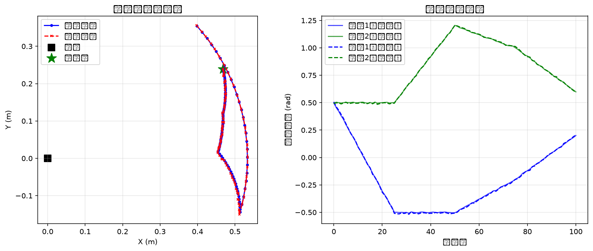
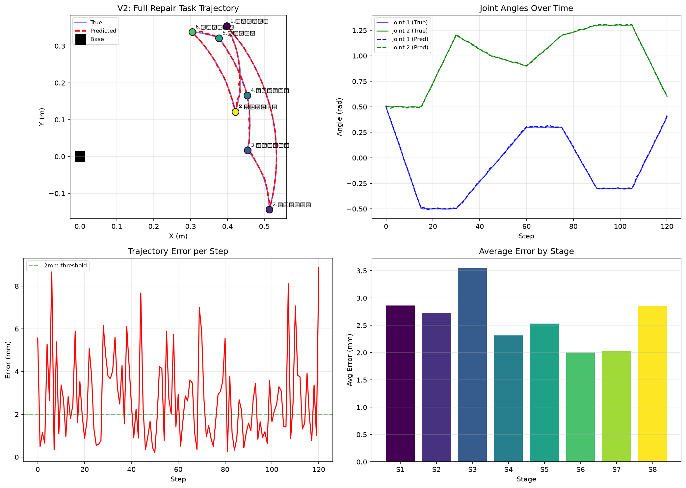

# auto-repair-mujoco


> 汽车后市场机器人技能包的开源仿真环境。
>
> 一个人，不买真机，在 MuJoCo 里把"电池包高压检查"这套汽车维修流程训成机器人策略。

## 项目介绍

这是「具身智能一人公司」的第一个开源产品——不是论文，不是 Demo 视频，是一个能跑、能训、能复现的仿真环境。

**为什么做这个？**
- 机器人公司（宇树、智元、Figure、Tesla）不懂汽车三电维修流程
- 汽车后市场（4S 店、维修厂、电池回收）不知道机器人能干什么
- 这个 repo 就是中间那座桥：**把汽车维修流程翻译成机器人能学的仿真任务**

## 核心特性

| 特性 | 说明 |
|---|---|
| 零硬件起步 | 不需要真机，纯仿真环境就能开发和训练 |
| 多版本递进 | V0 → V1 → V2 → V3，从简单到复杂逐步升级 |
| 完整管线 | 数据采集 → 行为克隆 → 轨迹预测 → 对比实验 |
| 可视化 | 自动生成轨迹图、误差分析、对比图表 |
| CPU 可跑 | 不需要 GPU，普通笔记本就能跑 demo |

## 快速开始

### 环境要求
- Python 3.11+
- PyTorch 2.x（CPU 即可）
- MuJoCo 3.x（可选，纯 PyTorch demo 不需要）

### 安装依赖
```bash
pip install -r requirements.txt
```

### 第一个 Demo（纯 PyTorch，零依赖）
```bash
python demo_torch.py
```

预期输出：
```
✅ 成功！机械臂到达电池包上方，误差 1.0 mm
   pipeline 跑通：采集数据 → MLP 行为克隆 → 到达目标
```

## 版本路线

### V0：单步 MLP Baseline
- **任务**：机械臂从 home 位置移动到电池包上方
- **模型**：MLP 行为克隆
- **结果**：最终位置误差 1mm
- **文件**：`demo_torch.py`

### V1：4阶段多步任务
- **任务**：移动 → 下降 → 拿扳手 → 举起（4个阶段）
- **模型**：Transformer Decoder 轨迹预测
- **结果**：最终位置误差 1.2mm
- **可视化**：`v1_trajectory.png`



### V2：8阶段完整维修流程
- **任务**：完整电池包检查流程（移动→下降→找验电笔→拿笔→检测→收回，8个阶段）
- **模型**：条件 Transformer（3层 decoder）
- **结果**：平均轨迹误差 2.7mm
- **可视化**：`v2_trajectory.png`



### V3：Diffusion Policy 对比实验
- **任务**：同 V2 的 8 阶段完整流程
- **对比**：Transformer Baseline vs 简化版 Diffusion Policy
- **结果**：在小数据集 + CPU 训练条件下，Transformer baseline 效果更优
- **结论**：Diffusion Policy 需要更多数据、更大模型才能发挥优势

## 项目结构

```
auto-repair-mujoco/
├── scene.xml           # MuJoCo 场景（工作台/电池包/工具/6-DOF机械臂）
├── collect_demo.py     # 采集演示数据（关键帧插值）
├── train.py            # 行为克隆训练（MLP baseline）
├── rollout.py         # 验证策略在仿真里跑起来
├── test_mujoco.py      # 快速验证 MuJoCo 环境是否正常
│
├── demo_torch.py       # V0：纯 PyTorch 单步 demo（不需要 MuJoCo）
├── demo_v1.py          # V1：4阶段 Transformer 轨迹预测
├── demo_v2.py          # V2：8阶段完整维修流程
├── demo_v3.py          # V3：Diffusion Policy 对比实验
│
├── v1_trajectory.png   # V1 可视化
├── v2_trajectory.png   # V2 可视化
│
├── run.sh              # 一键运行脚本
├── requirements.txt    # 依赖列表
├── LICENSE             # MIT License
├── README.md           # 项目说明
└── data/               # 采集的演示数据（gitignore）
```

## 完整 MuJoCo 流程

```bash
# 1. 采集 50 条演示轨迹
python collect_demo.py --num_episodes 50 --output data/

# 2. 训练行为克隆策略（MLP baseline，300 epochs）
python train.py --data data/auto_repair_demo.npz --epochs 300

# 3. Rollout 验证：看机械臂能不能到达电池包上方
python rollout.py --checkpoint checkpoints/bc_mlp.pt
```

## 为什么是汽车维修

- **市场够大**：中国新能源车保有量 2000 万辆，三电后市场每年千亿级
- **痛点够痛**：高压高危，人工不敢碰、不敢教、不敢学
- **机器人能干**：不是抢工人饭碗，是因为人根本不敢干
- **仿真先行**：仿真数据先行，真机跟上就是水到渠成

## 下一步路线

- [x] V0：最简场景 + MLP baseline
- [x] V1：4阶段任务 + Transformer 轨迹预测
- [x] V2：8阶段完整维修流程 + 条件生成
- [x] V3：Diffusion Policy 对比实验
- [ ] V4：换成 UR5 / Franka 真机模型，Sim2Real 迁移
- [ ] V5：打包成技能包，上架机器人应用商店（宇树 UniStore / 智元灵渠 OS）

## 关于作者

一个人玩具身智能。不买真机、不报班、不考 ROS 证。
在扣子上做了个「具身智能技术雷达」智能体，专门回答 VLA / Sim2Real / 数据 / 本体格局的问题。

## License

MIT
